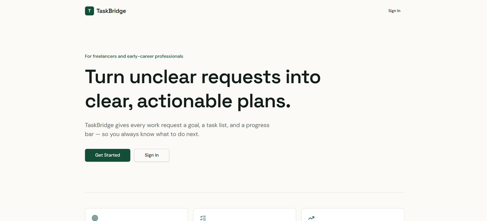
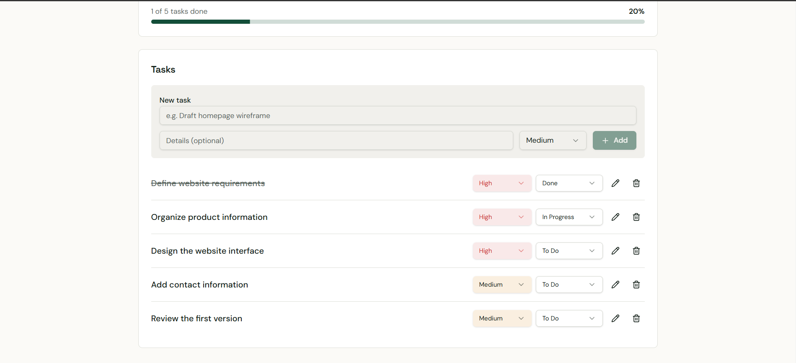
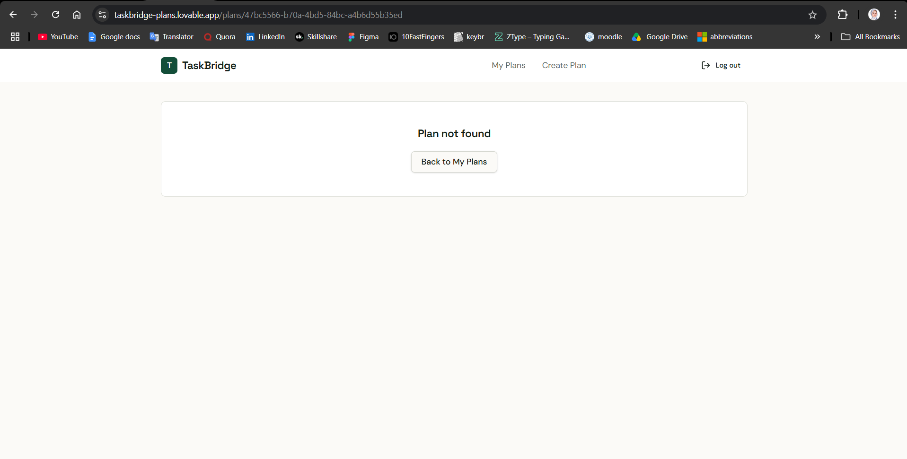
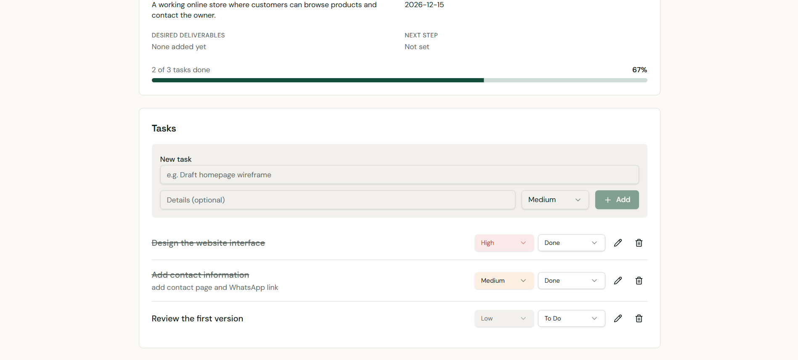
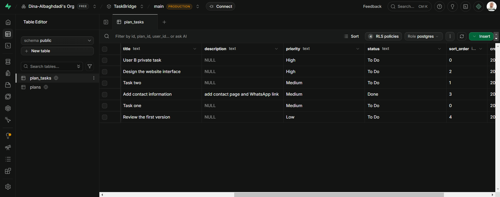

# TaskBridge

> Turn unclear work requests into clear, actionable plans — goals, tasks, priorities, statuses, and automatic progress, with each user's data protected at the database level.

**🌐 English** · [العربية](#-النسخة-العربية)

**Live app:** [taskbridge-plans.lovable.app](https://taskbridge-plans.lovable.app)



---

## ✨ Highlights

| | |
|---|---|
| 🔐 **Private by design** | Row Level Security on every table: a user cannot read another user's plan — even by opening its direct link. |
| 🧱 **Data integrity in the database** | Allowed values for priority and status, a task's owner must match its plan's owner, and deleting a plan deletes its tasks. |
| 📊 **Automatic progress** | `Done ÷ Total × 100`, recalculated on every change, and `0%` for a plan with no tasks. |
| 🧪 **Tested with two accounts** | 14 end-to-end tests on the published app, verified in the database. |

---

## 🎯 The Problem

People often know the outcome they want but not the steps: which tasks are needed, what comes first, what is done, and what is next. TaskBridge is built for freelancers, recent graduates, and early-career professionals who need to turn a goal into a plan they can track.

**Flow:** Goal → Plan → Tasks → Priorities → Status → Progress

---

## ⚙️ How It Works

```text
Sign up / Sign in (Supabase Auth)
  ↓
My Plans — only the signed-in user's plans
  ↓
Plan: title · description · goal · deadline
  ↓
Tasks: priority (High / Medium / Low) · status (To Do / In Progress / Done)
  ↓
Progress = Done ÷ Total × 100
```

| My plans | Tasks and progress |
|---|---|
|  |  |

---

## 🗄️ Database Design

```text
auth.users ─┬─< plans ─┬─< plan_tasks
            │          │
            └──────────┴── user_id on both tables
```

| Table | Key fields |
|---|---|
| `plans` | `id`, `user_id`, `title`, `description`, `goal`, `deadline`, `deliverables` (JSONB), `next_step`, timestamps |
| `plan_tasks` | `id`, `plan_id`, `user_id`, `title`, `description`, `priority`, `status`, `sort_order`, `created_at` |

**Integrity rules**
- `priority` ∈ `High`, `Medium`, `Low` and `status` ∈ `To Do`, `In Progress`, `Done` (CHECK constraints).
- Composite foreign key `(plan_id, user_id) → plans(id, user_id)`: a task can only belong to a plan owned by the same user.
- `ON DELETE CASCADE`: deleting a plan deletes its tasks.

**Security (RLS)** — enabled on both tables, with select / insert / update / delete policies that allow access only when `user_id = auth.uid()`. The full SQL is in [`supabase/migrations`](./supabase/migrations).

---

## 🧪 Testing

All tests ran on the published app with two separate accounts, and data changes were checked in Supabase.

| Area | What was tested | Result |
|---|---|---|
| Auth | Sign up and confirmation email, sign in, wrong password rejected, sign out and back in | ✅ |
| Plans | Create, list, edit, delete | ✅ |
| Tasks | Add, edit, delete, change priority and status | ✅ |
| Progress | 20% → 17% → 20%, 67% → 33%, `0 of 3 = 0%`, empty plan `0%` | ✅ |
| Persistence | Data unchanged after refresh and sign out / sign in | ✅ |
| Isolation | User B sees none of User A's plans; direct link returns *Plan not found*; User A cannot see User B's plan | ✅ |
| Integrity | Deleting a plan removes its tasks from `plan_tasks` | ✅ |

| Direct link to another user's plan | Progress recalculation |
|---|---|
|  |  |

**Cascade delete in the database** — before and after deleting the plan *Delete Test*:

| Before | After |
|---|---|
|  |  |

---

## 📁 Project Files

| File | Contents |
|---|---|
| [README.md](./README.md) | Project overview, design, and test results |
| [database-schema.md](./database-schema.md) | Tables, constraints, RLS policies, verification, and SQL |
| [lovable-build-prompt.md](./lovable-build-prompt.md) | The prompt used to build the app in Lovable |

---

## 🛠️ Tech Stack

| Tool | Role |
|---|---|
| Lovable | AI app builder used to generate the interface and logic from written requirements |
| Supabase Auth | Accounts and sessions |
| Supabase PostgreSQL | Plans, tasks, constraints, relations |
| Supabase RLS | Database-level access control |
| React, TanStack Start, Tailwind CSS | Generated frontend |

---

## 🏗️ How It Was Built

The app was generated with **Lovable**. My part: defining the requirements, designing the data model, integrity rules, and RLS policies, guiding the build in stages, and testing every function in the running app and the database with two accounts.

---

## 🔮 Next Steps

- Generate a first plan from a goal written in natural language.
- Deadline reminders through an automation platform.
- Progressive Web App.

---

## 👩‍💻 Author

**Dina Albaghdadi** — AI Automation

[LinkedIn](https://www.linkedin.com/in/dina-albaghdadi-79bb9a25a/) · [GitHub](https://github.com/Dina-Albaghdadi)

---
---

<div dir="rtl">

## 🌍 النسخة العربية

> تطبيق يحوّل طلبات العمل غير الواضحة إلى خطط قابلة للتنفيذ: أهداف ومهام وأولويات وحالات ونسبة إنجاز تلقائية، مع حماية بيانات كل مستخدم على مستوى قاعدة البيانات.

### ✨ أبرز النقاط

- 🔐 **خصوصية من التصميم:** سياسات RLS على كل جدول، فلا يستطيع مستخدم قراءة خطة غيره حتى لو فتح رابطها مباشرة.
- 🧱 **سلامة البيانات في قاعدة البيانات:** قيم محددة للأولوية والحالة، ومالك المهمة يجب أن يكون مالك الخطة، وحذف الخطة يحذف مهامها.
- 📊 **تقدم تلقائي:** يُحسب من حالات المهام عند كل تغيير، و0% للخطة الفارغة.
- 🧪 **مُختبر بحسابين:** 14 اختبارًا على التطبيق المنشور مع التحقق من قاعدة البيانات.

### 🗄️ تصميم قاعدة البيانات

جدولا `plans` و`plan_tasks` مرتبطان بالمستخدم، مع قيود CHECK للأولوية والحالة، ومفتاح أجنبي مركّب يضمن أن مالك المهمة هو مالك الخطة، وحذف متسلسل، وسياسات RLS للقراءة والإضافة والتعديل والحذف.

### 🧪 الاختبارات

المصادقة، وإدارة الخطط والمهام، وحساب التقدم، وحفظ البيانات، وعزل المستخدمين (بما فيه الرابط المباشر)، والحذف المتسلسل: كلها نجحت.

### 🏗️ كيف بُني

بُني بـ**Lovable**. دوري: تحديد المتطلبات، وتصميم نموذج البيانات والقيود وسياسات RLS، وتوجيه البناء على مراحل، واختبار كل وظيفة في التطبيق وقاعدة البيانات بحسابين.

</div>
